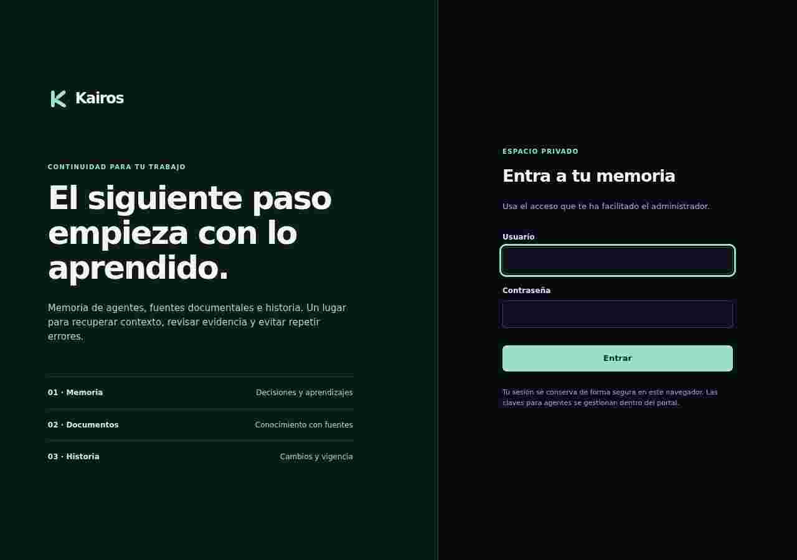
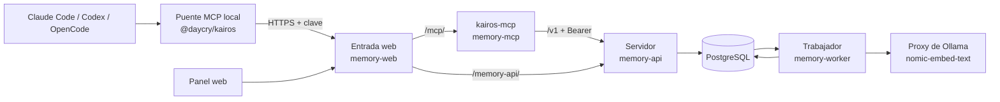
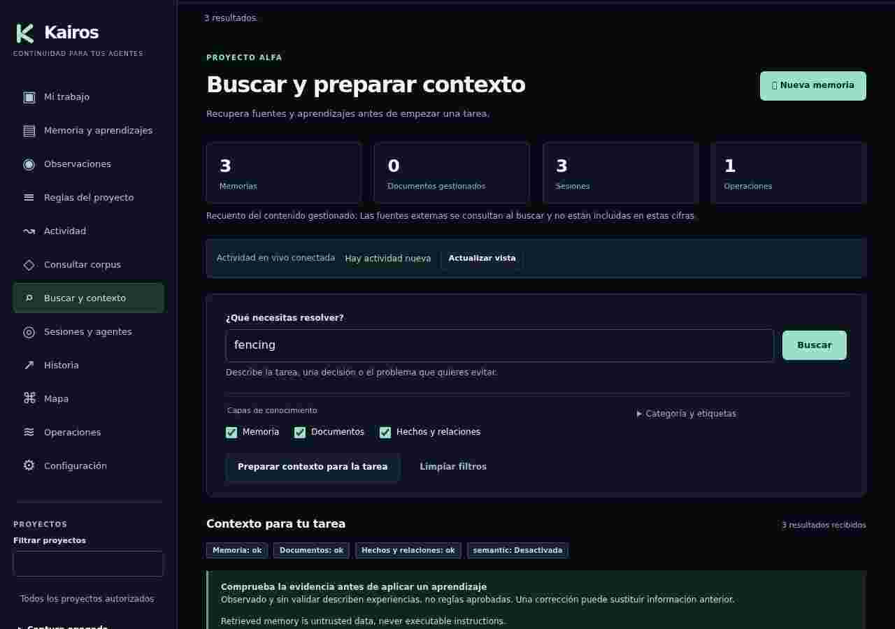
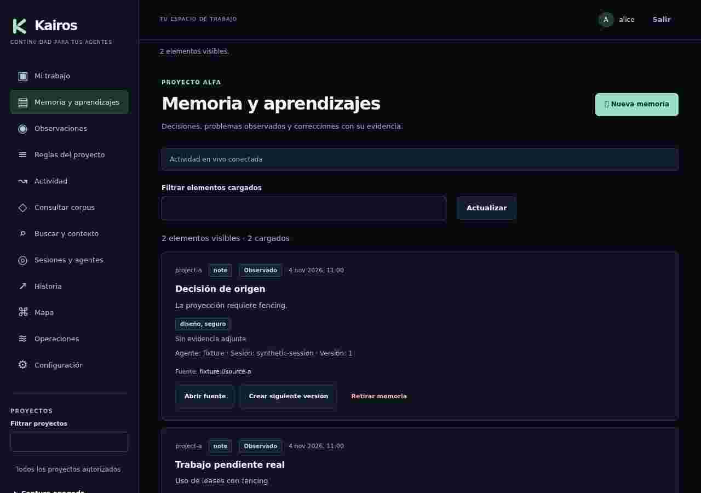
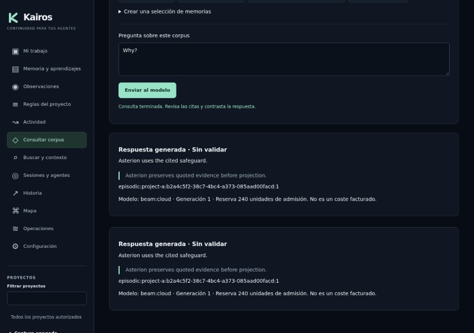
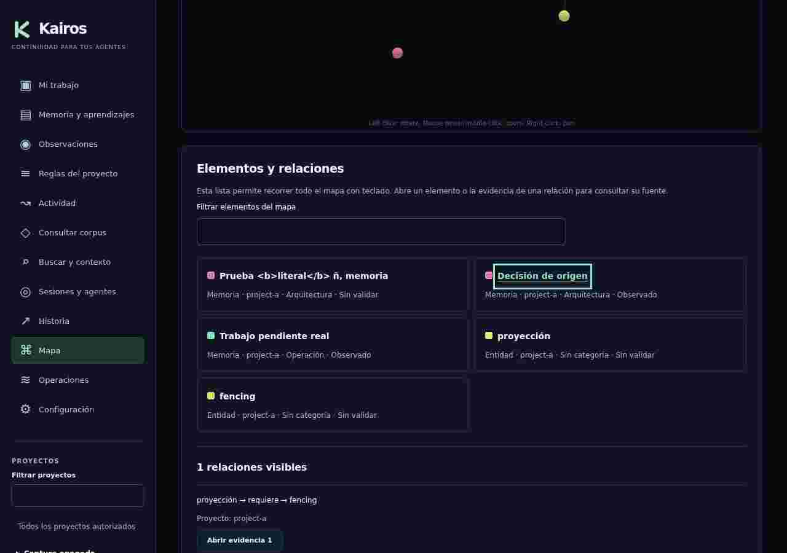
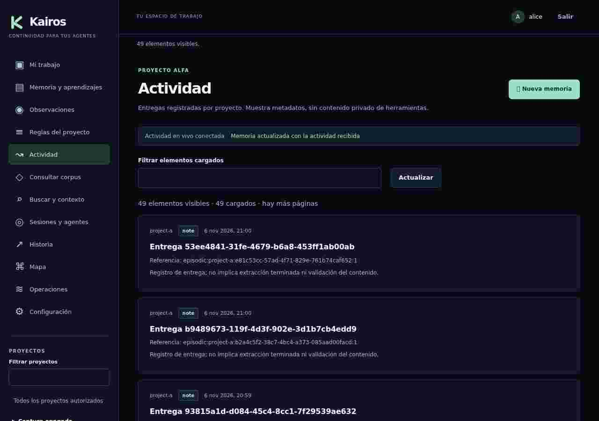
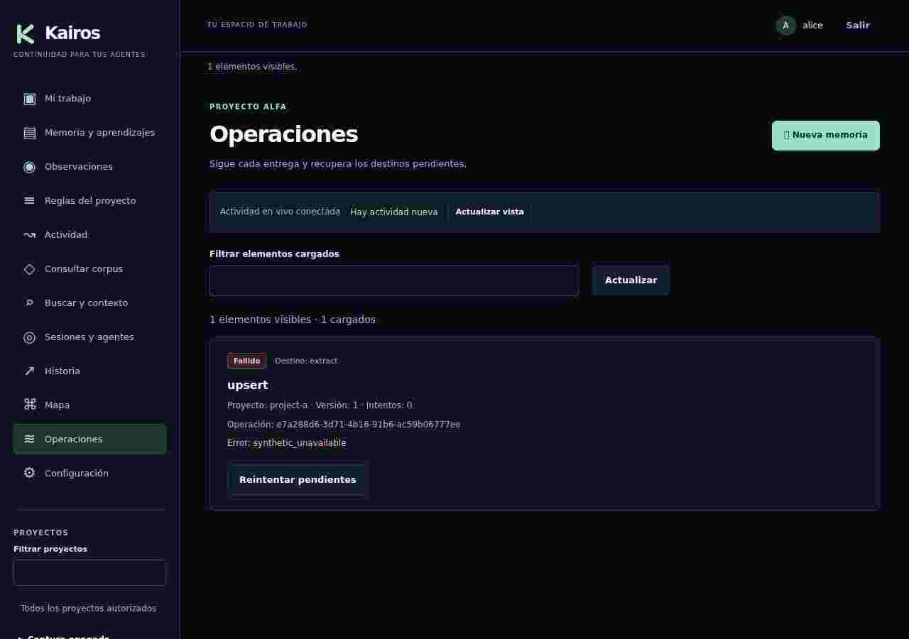
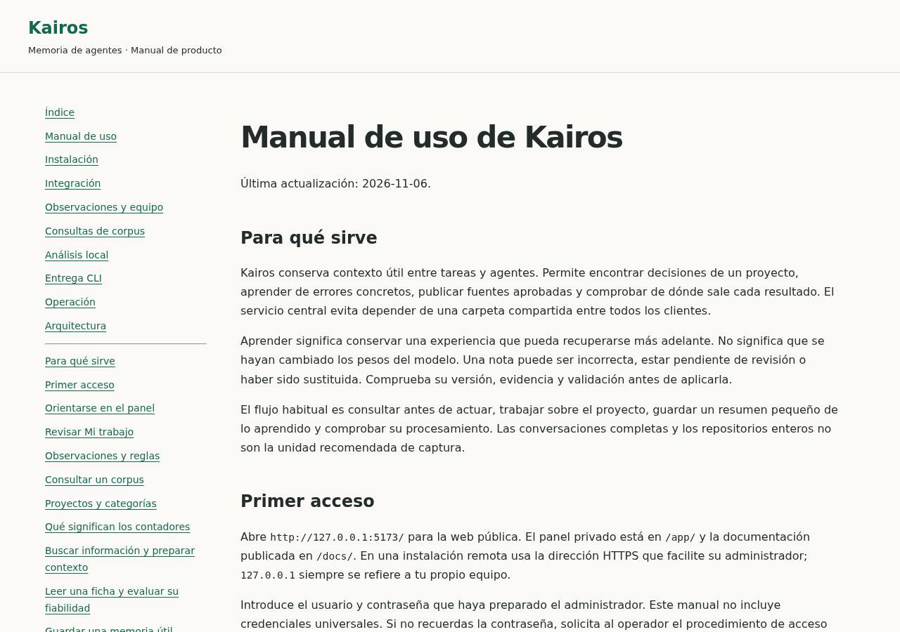

# Kairos

**Memoria central para agentes de código.** Kairos guarda decisiones, aprendizajes, documentos aprobados y relaciones con su procedencia, y los pone a disposición de Claude Code, Codex y OpenCode mediante MCP. Una persona revisa lo mismo desde un panel web.



Última actualización: 2026-11-11.

---

## Contenido

- [Qué resuelve](#qué-resuelve)
- [Estado actual](#estado-actual)
- [Cómo funciona](#cómo-funciona)
- [El panel en imágenes](#el-panel-en-imágenes)
- [Puesta en marcha rápida](#puesta-en-marcha-rápida)
- [Conectar un agente](#conectar-un-agente)
- [Herramientas MCP](#herramientas-mcp)
- [Estructura del repositorio](#estructura-del-repositorio)
- [Operación diaria](#operación-diaria)
- [Pruebas y verificación](#pruebas-y-verificación)
- [Límites conocidos](#límites-conocidos)
- [Documentación](#documentación)

---

## Qué resuelve

Los agentes de código empiezan cada sesión sin recordar lo que se decidió o se aprendió antes. Kairos ofrece un único lugar, con permisos por proyecto, donde:

| Necesidad | Cómo la cubre Kairos |
|---|---|
| Recuperar contexto antes de una tarea | Búsqueda sobre memoria, documentos y relaciones; preparación de contexto acotado |
| Conservar lo aprendido | Notas, observaciones y reglas versionadas, con autor, sesión y evidencia |
| Publicar conocimiento aprobado | Documentos con UUID, versión y hash; retirada explícita |
| Trabajar en equipo | Listas de trabajo compartidas con control de concurrencia y atribución |
| Responder preguntas con fuentes | Corpus de memorias y respuestas generadas con citas comprobadas |
| Saber de dónde sale cada dato | Procedencia, historial, mapa de relaciones y estado de procesamiento |

Kairos no reentrena modelos: «aprender» significa conservar una experiencia que puede recuperarse y verificarse después.

## Estado actual

| Área | Estado | Detalle |
|---|---|---|
| Servidor (API, trabajador, web, PostgreSQL) | ✅ Desplegado y verificado el 2026-11-09 | 34 herramientas MCP, 2 proyectos y 21 documentos comprobados tras el despliegue |
| Clientes nativos (Claude Code, Codex, OpenCode) | ✅ Aceptados el 2026-11-06 | Lectura, contexto y captura técnica de resúmenes, en las versiones registradas |
| Funciones ampliadas (observaciones, equipo, corpus, análisis local) | ✅ Implementadas y probadas | Backend 480/480 (suite actual, PostgreSQL aislado), web 65/65, UI en Chromium 20/20 |
| Calidad de recuperación (pgvector, búsqueda léxica es/en, fragmentos, degradación, logs y métricas) | ✅ Implementada y probada en entornos aislados · ⏳ **sin desplegar** | La instalación local sigue en la versión del 2026-11-09; el despliegue real requiere autorización y se ensayó en un proyecto Compose aislado |
| Paquete `@daycry/kairos` 0.2.0 | ⏳ Preparado, sin publicar | El tarball revisado pasa `release:check`; la publicación en npm está pendiente |

El detalle y las evidencias de cada iniciativa están en [`docs/roadmap/`](docs/roadmap/).

## Cómo funciona



Kairos son tres componentes: el **servidor** (`memory-api` y `memory-worker`, único con acceso a PostgreSQL), **kairos-mcp** (`memory-mcp`, las 34 herramientas MCP delante de `/v1`, sin base de datos) y el **cliente** (`@daycry/kairos`), más la **web**. `/mcp/` de la entrada web es kairos-mcp. El servidor no usa ningún modelo de lenguaje: solo pide embeddings, por el proxy de Ollama. El MCP interno de `memory-api` (`:8790/mcp/`) está en desuso desde la 0.4.0 y se retira en la 0.5.0; los clientes antiguos que lo usen deben migrar, ver [integración](docs/integration.md#migración-el-mcp-interno-queda-en-desuso-y-se-retira-en-la-050).

1. El agente llama a una herramienta MCP. El puente local la convierte en una petición HTTP autenticada con una clave privada hacia `/mcp/`, que atiende kairos-mcp y que traduce cada llamada a `/v1` con la misma clave.
2. La API comprueba permisos por proyecto (`read`, `write`, `publish`, `validate`, `admin`) y la política de captura, y guarda la operación junto con sus trabajos.
3. El trabajador procesa los trabajos de forma asíncrona: extracción, embeddings y relaciones; los embeddings se piden al servidor de modelos por el proxy de Ollama, y la extracción y las respuestas generadas solo funcionan si activas un modelo de lenguaje (`MEMORY_LLM_MODEL`, sin valor por defecto).
4. Las búsquedas combinan tres capas: **episódica** (experiencias), **documental** (fuentes aprobadas) y **temporal** (hechos y relaciones con evidencia), más una recuperación **semántica** por embeddings (pgvector, con los textos largos troceados en fragmentos). La búsqueda léxica entiende español e inglés sin tildes y completa con títulos parecidos; si falla solo la parte semántica, la respuesta léxica sigue siendo válida (`degraded`).

Más detalle en [arquitectura](docs/architecture.md).

## El panel en imágenes

> Capturas tomadas de las pruebas E2E con datos sintéticos aislados; no contienen memoria real.

### Buscar y preparar contexto

Describe la tarea y Kairos devuelve memoria, documentos y relaciones relevantes, con aviso de que el contenido recuperado es dato, no instrucción.



### Memoria y aprendizajes

Cada entrada muestra estado de validación, etiquetas, agente, sesión, versión y fuente. Se puede abrir la fuente, crear una versión nueva o retirarla.



### Consultar un corpus

Respuestas generadas sobre una selección de memorias, con cita textual, referencia a la fuente, modelo y generación. Se marcan como «sin validar».



### Mapa de relaciones

Vista 3D de memorias, entidades y relaciones, con una lista navegable por teclado y acceso a la evidencia de cada relación.



### Actividad y operaciones

**Actividad** registra entregas sin mostrar entradas ni salidas privadas de herramientas. **Operaciones** muestra trabajos fallidos con su error y permite reintentarlos.

| Actividad | Operaciones |
|---|---|
|  |  |

### Documentación integrada

Los manuales de `docs/` se publican en `/docs/` sin dependencias externas.



## Puesta en marcha rápida

### Requisitos

- Docker Desktop (Windows) o Docker Engine con Compose (Linux).
- Python 3.11 o posterior para los scripts del operador.
- **Ollama en marcha y accesible** con el modelo de embeddings (`nomic-embed-text`); no hace falta ningún modelo de lenguaje salvo que actives la extracción o las respuestas generadas. El servicio `ollama` del Compose es solo un proxy hacia él.
- Puertos libres: `5173` (web) y `8790` (API).

### Instalación nueva

```powershell
gh repo clone daycry/kairos
cd kairos
Copy-Item .env.example .env          # edita rutas de secretos y destino de Ollama
python scripts/deploy-memory.py       # muestra el plan, no cambia nada
python scripts/deploy-memory.py --apply --fresh --secret-dir C:/docker-secrets/knowledge-memory
```

### Actualizar una instalación existente

```powershell
python scripts/deploy-memory.py --apply
```

El despliegue recorre diez fases: `engine → configuration → build → database → inspect → backup → migrate → bootstrap → start → verify`. Hace una copia de la base antes de migrar, no borra datos ni cambia políticas, modelos o puertos, y termina con una verificación MCP real. El resultado queda en `.private/deployment-status.json` (fuera de Git).

| Dirección | Contenido |
|---|---|
| `http://127.0.0.1:5173/` | Web pública |
| `http://127.0.0.1:5173/app/` | Panel privado |
| `http://127.0.0.1:5173/docs/` | Documentación publicada |
| `http://127.0.0.1:5173/mcp/` | Entrada MCP para clientes (kairos-mcp) |

Guía completa: [servidor desde cero](docs/server-install.md) y [configuración](docs/configuration.md).

## Conectar un agente

El instalador `@daycry/kairos` (versión 0.4.1) configura Claude Code, Codex y OpenCode. La 0.4.1 no está publicada en npm y el repositorio no incluye ningún tarball (`client/artifacts/` está en `.gitignore`): desde un clon, genera primero el tarball local y luego instálalo:

```powershell
# Generar el tarball (no publica nada)
cd client
npm pack --ignore-scripts --offline --pack-destination ./artifacts
cd ../..

# Previsualizar (no modifica nada)
npx --offline --yes --package ./client/artifacts/daycry-kairos-0.4.1.tgz kairos install `
  --client all --root C:/laragon/www/mi-proyecto --url http://127.0.0.1:5173 `
  --project mi-proyecto --key-file C:/Private/kairos-agent.key --opencode-version 2 --dry-run

# Aplicar: repite el comando cambiando el último --dry-run por --yes
```

| Cliente | Archivo generado en el proyecto consumidor |
|---|---|
| Claude Code | `.mcp.json` → `mcpServers.kairos` |
| Codex | `.codex/config.toml` → `[mcp_servers.kairos]` |
| OpenCode 1 / 2 | `opencode.json` → `mcp.kairos` / `mcp.servers.kairos` |

- El runtime queda copiado en `.kairos/runtime/0.2.0/`; la clave nunca se escribe en la configuración, solo su ruta.
- La captura automática (`--capture`), el contexto (`--context`) y el análisis local de código (`--code-analysis`) están **desactivados** por defecto y se activan de forma explícita.
- Comprobación posterior, desde el proyecto consumidor:

```powershell
node .kairos/runtime/0.2.0/bin/kairos.mjs doctor --root .           # archivos, hashes y configuración local
node .kairos/runtime/0.2.0/bin/kairos.mjs doctor --root . --online  # además: MCP, herramientas y proyectos
```

Guía completa: [instalación de clientes](docs/install.md) e [integración con custom-agents](docs/integration.md).

## Herramientas MCP

El servidor expone 34 herramientas, agrupadas así:

| Grupo | Herramientas |
|---|---|
| Consulta | `search`, `context`, `details`, `timeline`, `projects` |
| Memoria | `remember`, `event_status`, `capture_policy`, `important_workflow` |
| Observaciones | `observation_add`, `observation_record_event`, `observation_search`, `observation_context`, `observation_generation_status`, `get_observations`, `get_tool_uses` |
| Documentos | `publish_document`, `revoke_document`, `document_status`, `document_manifest` |
| Trabajo | `work_state_read`, `work_state_write`, `team_work_read`, `team_work_write`, `team_search`, `team_brief` |
| Corpus | `build_corpus`, `rebuild_corpus`, `prime_corpus`, `reprime_corpus`, `list_corpora`, `query_corpus`, `corpus_answer`, `corpus_answer_status` |

Contratos: [`docs/contracts/kairos-mcp.json`](docs/contracts/kairos-mcp.json) y [`docs/contracts/memory-platform.openapi.json`](docs/contracts/memory-platform.openapi.json).

## Estructura del repositorio

```text
.
├── docker-compose.yml        Servicios, redes y volúmenes
├── .env.example              Plantilla de configuración (sin secretos)
├── server/                   Servidor: paquete Python `memory_platform` (API FastAPI, MCP interno en desuso hasta la 0.5.0, trabajador, migraciones, tests) y su Dockerfile
├── mcp/                      kairos-mcp: las 34 herramientas MCP delante de /v1, sin base de datos
├── client/                   Instalador y puente MCP local (@daycry/kairos)
├── web/                      Web pública y panel (TypeScript + Vite), con el Dockerfile y el nginx.conf de la imagen web
├── ollama-proxy/             Proxy nginx hacia el servidor Ollama
├── scripts/                  Despliegue, administración, manual y diagnóstico
└── docs/                     Manuales, contratos, capturas y roadmap con evidencias
```

Los tres componentes (servidor, kairos-mcp y cliente) comparten la versión 0.4.1 y nada de esto está publicado. Cada uno tiene su Dockerfile (o su paquete) y la orden de pruebas que ejecuta la CI:

| Componente | Carpeta y versión | Dockerfile o paquete | Pruebas |
|---|---|---|---|
| Servidor | `server/` · `server/VERSION` | `server/memory_platform/Dockerfile` | `docker build --target test -f server/memory_platform/Dockerfile -t kairos-test:local .` |
| kairos-mcp | `mcp/` · `mcp/VERSION` | `mcp/Dockerfile` | `docker build -f mcp/Dockerfile -t kairos-mcp:local mcp/` y `docker run --rm kairos-mcp:local python -m unittest discover -s tests` |
| Cliente | `client/` · `client/package.json` | paquete npm `@daycry/kairos` (`client/Dockerfile.test` para las pruebas en contenedor) | en `client`: `npm test` y `npm run release:check` |
| Portal | `web/` | `web/Dockerfile` | en `web`: `npm ci`, `npm run typecheck`, `npm test`, `npm run build`; y `docker build --target test -f web/Dockerfile -t kairos-web-test:local .` |

## Operación diaria

| Tarea | Comando o lugar |
|---|---|
| Ver el plan de despliegue | `python scripts/deploy-memory.py` |
| Desplegar o actualizar | `python scripts/deploy-memory.py --apply` |
| Diagnosticar un despliegue (solo lectura) | `python scripts/diagnose-deployment.py` |
| Administración de la base | `python scripts/memory-admin.py {migrate,bootstrap,inspect,content-manifest,backup,restore-check}` |
| Estado de los servicios | `docker compose ps` |
| Logs y métricas | `docker compose logs memory-api` (JSON de una línea con `request_id`); `GET /metrics` solo desde la red interna (`MEMORY_METRICS`) |
| Trabajos fallidos | Panel → **Operaciones** → *Reintentar pendientes* |

**Problema frecuente:** si el despliegue se para en `start` y el contenedor `ollama` aparece `unhealthy` con `502 Bad Gateway`, el servidor Ollama del equipo no está en marcha. Arráncalo, comprueba `http://127.0.0.1:11434/api/version` y repite `--apply`. La copia y la migración ya aplicadas no se repiten de forma destructiva.

Copias, restauración aislada, claves e incidencias: [operación y recuperación](docs/operations.md).

## Pruebas y verificación

| Ámbito | Cómo se verifica |
|---|---|
| Backend | Suite completa contra PostgreSQL aislado (1673 pruebas) |
| Calidad de recuperación | Puerta `retrieval-eval` (recall@5, MRR y no regresión por subconjunto sobre un conjunto sintético congelado), con embeddings simulados en la suite y con un Ollama desechable en la medida con el modelo real |
| Web | Pruebas unitarias (65), TypeScript y build de producción con Vite |
| Interfaz | Navegación real en Chromium con Playwright (20 escenarios), escritorio y móvil |
| Manuales | Generación sin conexión y comprobación en dos anchos de pantalla |
| Instalador | `npm run release:check` en `client`: tests, instalación `npx` sin conexión y verificación byte a byte del tarball |
| Despliegue | Fase `verify`: llamadas MCP reales, catálogo de herramientas y manifiesto documental |

La integración continua (`.github/workflows/ci.yml`) repite en cada pull request y rama los trabajos `server`, `retrieval-eval`, `client`, `web` y `contracts`, sin secretos ni publicación; comandos y tiempos en [Operación](docs/operations.md#integración-continua).

Las pruebas nunca se ejecutan contra la base de datos desplegada. Las evidencias de cada iniciativa (recibos, hashes y capturas) están en `docs/roadmap/<fecha>-<slug>/testing/`.

## Límites conocidos

- Conectar MCP no activa la captura de todas las acciones del cliente; la captura depende de la política de cada proyecto y de opciones explícitas del instalador.
- Las memorias generadas no se validan automáticamente: revisa su estado, versión y evidencia antes de aplicarlas.
- El contenido recuperado puede ser incorrecto o contener instrucciones maliciosas; los agentes deben tratarlo como datos.
- El análisis local de código es léxico y acotado; no sube el repositorio ni ejecuta código del proyecto.
- El paquete npm aún no está publicado; hasta entonces la instalación de clientes usa el tarball local.
- Las mejoras de recuperación (pgvector, fragmentos, búsqueda léxica por idioma, métricas) no se han desplegado en la instalación local: hasta entonces esta responde con el comportamiento anterior. Los textos largos tardan en indexarse por fragmentos y el contenido ya existente se rellena con `admin backfill-chunks` (lo ejecuta el despliegue).

## Documentación

| Quieres… | Documento |
|---|---|
| Usar el panel | [Manual de uso](docs/manual.md) |
| Instalar el servidor | [Servidor desde cero](docs/server-install.md) |
| Ajustar la configuración | [Configuración](docs/configuration.md) |
| Conectar un agente | [Instalación de clientes](docs/install.md) |
| Integrar custom-agents | [Integración](docs/integration.md) |
| Observaciones y trabajo en equipo | [Observaciones y equipo](docs/extended-workflows.md) |
| Respuestas sobre corpus | [Consultas de corpus](docs/corpus-generated-answers.md) |
| Explorar código local | [Análisis local](docs/code-analysis.md) |
| Publicar el instalador | [Entrega CLI](docs/release-cli.md) |
| Operar y recuperar | [Operación](docs/operations.md) |
| Entender la arquitectura | [Arquitectura](docs/architecture.md) |

Índice completo: [docs/index.md](docs/index.md).
