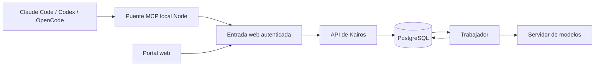

# Cómo está construido Kairos

Última actualización: 2026-11-09.

## Componentes y recorrido de una operación

El puente MCP convierte mensajes stdio en peticiones HTTP autenticadas. El servidor comprueba los permisos por proyecto y persiste la operación junto con sus trabajos. El trabajador genera las representaciones derivadas. Las búsquedas y fichas consultan la memoria central; el cliente no necesita acceso a carpetas del servidor.

| Unidad | Responsabilidad | Fuente |
|---|---|---|
| `memory_platform` | API, autenticación, modelos, persistencia, recuperación y procesamiento | [paquete](../memory_platform/__init__.py) |
| `memory_platform/mcp.py`, `agent_tools.py`, `extended_tools.py` y `corpus_answer_tools.py` | Frontera única de 34 herramientas para agentes | [MCP](../memory_platform/mcp.py) |
| `memory_platform/admin.py` | Migración, usuario inicial, inspección, copias y restauración de comprobación | [administración](../memory_platform/admin.py) |
| `web` | Web pública, acceso y panel privado, filtros, listas y mapa | [portal](../web/src/memory-portal.ts) |
| `packages/kairos-cli` | Instalación de configuración y puente MCP local | [manifiesto](../packages/kairos-cli/package.json) |
| `docker-compose.yml` | Servicios, redes y almacenamiento persistente | [Compose](../docker-compose.yml) |

## Stack y configuración

El backend usa Python, FastAPI, Pydantic y PostgreSQL mediante psycopg. MCP usa FastMCP. La web usa TypeScript y Vite; el mapa carga su renderizador cuando se utiliza. El instalador usa Node `>=20.12.0`, módulos ECMAScript y ninguna dependencia npm de ejecución. Las versiones exactas son las declaradas en los manifiestos del código, no las de este documento.

Los modelos configurados en la instalación existente son `beam:cloud` para generación y `nomic-embed-text` para embeddings. El motor de modelos sigue siendo necesario para esas funciones. La persistencia y la autenticación son responsabilidades del servicio central. Cambiar el modelo requiere una decisión operativa y comprobaciones de compatibilidad; instalar un cliente no lo cambia.

## Tres capas de recuperación

| Capa | Contenido | Interpretación |
|---|---|---|
| Episódica | Notas, resúmenes, correcciones y aprendizajes de sesiones | Experiencias con su validación y versión |
| Documental | Fuentes publicadas con aprobación y hash | Conocimiento gestionado con procedencia |
| Temporal | Hechos y relaciones con evidencia | Representación derivada que debe contrastarse con su fuente |

La capa semántica usa PostgreSQL con pgvector (imagen propia, ver [operación](operations.md#imagen-postgresql)). Cada embedding se guarda en `memory.embeddings` en dos columnas: `vector` (`double precision[]`, la original, que permite volver atrás) y `embedding` (tipo `vector` de pgvector, con su dimensión en `dims`). Para el modelo y la dimensión configurados (por defecto `nomic-embed-text` de 768) la consulta usa un índice HNSW parcial con escaneo iterativo; cualquier otro modelo o dimensión usa una ruta exacta en SQL. Ambas rutas aplican los mismos filtros de permisos, proyecto, versión vigente y hash, y la recomprobación final de autorización. Los detalles y parámetros están en [configuración](configuration.md#búsqueda-vectorial-pgvector).

La política de cada proyecto determina qué nuevos eventos se admiten y si se conservan hechos y relaciones. Una memoria generada no recibe automáticamente el estado validado. La eliminación lógica y las versiones evitan recuperar elementos retirados como si siguieran vigentes.

## Seguridad y fronteras

Los permisos son `read`, `write`, `publish`, `validate` y `admin`. Se comprueban además los proyectos autorizados; conocer un UUID no concede acceso. El navegador usa sesión y protección CSRF en mutaciones. El puente de agentes usa una clave leída de un fichero privado externo al proyecto consumidor.

Los títulos, etiquetas y contenidos se muestran como texto. Una fuente recuperada puede contener instrucciones maliciosas o información incorrecta: el agente debe tratarla como datos y conservar su procedencia.

## Qué está implementado y qué requiere aceptación

La interfaz MCP implementa 34 herramientas; su lista está en [integración](integration.md). El estado de trabajo privado, el trabajo compartido y los corpus utilizan tablas separadas bajo la misma migración transaccional. Los corpus conservan referencias de generación, sin duplicar el cuerpo de las fuentes; verifican cambios y retiradas antes de devolver evidencia o usar caché. `query_corpus` ofrece recuperación léxica. `corpus_answer` añade síntesis explícita con continuidad acotada, presupuesto de admisión persistido y comprobación de citas. La llamada al proveedor ocurre fuera de la transacción; se revalidan permisos y fuentes antes de guardar o recuperar el resultado. Un timeout conserva su estado incierto sin reenviar.

El instalador configura las tres familias de clientes, verifica el estado local y ofrece una comprobación remota de lectura. Con opciones explícitas fusiona hooks o un adaptador nativo. Un dispatcher Node separado recibe IPC autenticado en loopback y mantiene una outbox privada externa al proyecto. Verifica permisos y política antes de admitir y antes de enviar; los recibos y los cuerpos tienen persistencias distintas. No usa la sesión MCP del agente para tareas internas y no lee transcripciones. El consentimiento local se relee en un dispatcher ya activo. El contexto exige lectura autorizada vigente y no tiene caché local de respaldo. La lectura, el contexto y la captura técnica de resúmenes se aceptaron en los tres clientes reales el 6 de noviembre de 2026, en las versiones indicadas en el [cierre nativo](roadmap/2026-11-05-automatic-memory/testing/native-acceptance-closure.md). Ese resultado no acredita automáticamente las funciones añadidas después. Su activación en el servidor local se verificó el 9 de noviembre de 2026 mediante la fase `verify` del despliegue.

El análisis local opcional se realiza en el proxy y tiene una raíz de cliente explícita, exclusiones antes de la lectura y presupuestos. No permite al servidor abrir rutas del cliente ni publica código automáticamente. Véase [análisis local](code-analysis.md).

La suite de cada componente y las pruebas aisladas no sustituyen la aceptación del producto desplegado: publicar y recuperar un documento, guardar una memoria, esperar los trabajos, abrir la ficha y comprobar su procedencia desde el cliente real. No se afirma que todas las funciones de cualquier otra herramienta estén implementadas.
