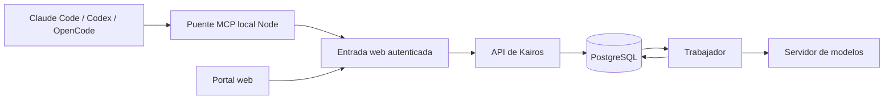
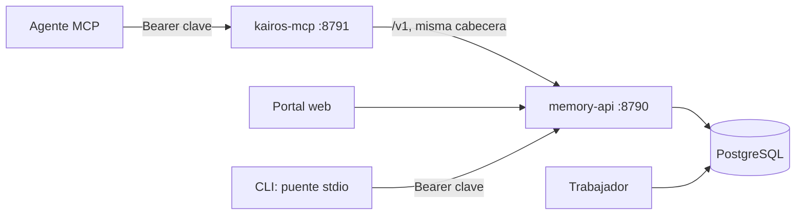

# Cómo está construido Kairos

Última actualización: 2026-11-14.

## Componentes y recorrido de una operación

El puente MCP convierte mensajes stdio en peticiones HTTP autenticadas. El servidor comprueba los permisos por proyecto y persiste la operación junto con sus trabajos. El trabajador genera las representaciones derivadas. Las búsquedas y fichas consultan la memoria central; el cliente no necesita acceso a carpetas del servidor.

| Unidad | Responsabilidad | Fuente |
|---|---|---|
| `memory_platform` | API, autenticación, modelos, persistencia, recuperación y procesamiento | [paquete](../server/memory_platform/__init__.py) |
| `server/memory_platform/mcp.py`, `agent_tools.py`, `extended_tools.py` y `corpus_answer_tools.py` | MCP interno: las 34 herramientas sobre el servidor, con credencial por clave o por sesión del portal | [MCP](../server/memory_platform/mcp.py) |
| `mcp` (`kairos_mcp`) | kairos-mcp: las mismas 34 herramientas como cliente de `/v1`, con la credencial de quien llama; sin base de datos ni secretos | [README](../mcp/README.md) |
| `server/memory_platform/store.py` y `store_*.py` | `Store` es una fachada sobre mixins por dominio (autenticación, ingesta, documentos, grafo, trabajos y vectores); el código que usa `Store` no cambió | [fachada](../server/memory_platform/store.py) |
| `server/memory_platform/observability.py` | Logs JSON con redacción y métricas Prometheus de valores cerrados | [observabilidad](../server/memory_platform/observability.py) |
| `server/memory_platform/admin.py` | Migración, usuario inicial, inspección, copias, relleno de fragmentos y restauración de comprobación | [administración](../server/memory_platform/admin.py) |
| `web` | Web pública, acceso y panel privado, filtros, listas y mapa | [portal](../web/src/memory-portal.ts) |
| `client` | Instalación de configuración y puente MCP local | [manifiesto](../client/package.json) |
| `docker-compose.yml` | Servicios, redes y almacenamiento persistente | [Compose](../docker-compose.yml) |

## Tres componentes: servidor, kairos-mcp y cliente

- **Servidor** (`memory-api` y `memory-worker`): único con acceso a PostgreSQL. Autentica, aplica los permisos por proyecto y expone la API REST `/v1`. Mantiene además el MCP interno (`memory-api:8790/mcp/`), con sus cabeceras de sesión y CSRF, en desuso desde la 0.4.0 y retirado en la 0.5.0: ya no lo sirve el proxy web, responde con `Deprecation` y `Sunset`, y `MEMORY_MOUNT_MCP=0` lo desmonta.
- **kairos-mcp** (`memory-mcp`, puerto `8791`): publica `/mcp/` con las 34 herramientas del contrato `docs/contracts/kairos-mcp.json` y convierte cada llamada en una petición `/v1` con la misma cabecera `Authorization: Bearer`. No accede a la base de datos, no tiene credencial propia, no decide permisos y no importa código del servidor. Vive en una red interna que solo comparte con `memory-api`. Añade a las respuestas de lectura los campos `untrusted` y `warning` (dato no fiable) y aplica los topes de bytes de las herramientas. Detalle en [mcp/README.md](../mcp/README.md).
- **Cliente** (`client` y el portal): el CLI instala la configuración y mantiene el puente stdio; habla con `/mcp/` de la entrada web, que el proxy enruta a kairos-mcp (`memory-web` está en la red interna `mcp` y espera a `memory-mcp`). El puente no cambia; ambos servidores dan los mismos resultados salvo las diferencias de [integración](integration.md#conectar-con-kairos-mcp) (las pruebas de comportamiento MCP se ejecutan contra los dos mientras exista el interno).

Quién habla con quién: el agente solo habla con un MCP; kairos-mcp solo habla con `/v1`; solo el servidor habla con la base de datos y con el servidor de modelos de embeddings. Una clave sin permiso recibe el mismo error por cualquiera de los dos MCP, y un 401 de `/v1` es el 401 de la petición MCP.

## Stack y configuración

El backend usa Python, FastAPI, Pydantic y PostgreSQL mediante psycopg. MCP usa FastMCP. La web usa TypeScript y Vite; el mapa carga su renderizador cuando se utiliza. El instalador usa Node `>=20.12.0`, módulos ECMAScript y ninguna dependencia npm de ejecución. Las versiones exactas son las declaradas en los manifiestos del código, no las de este documento.

El modelo de embeddings configurado es `nomic-embed-text`; `MEMORY_LLM_MODEL` no tiene valor por defecto y solo hace falta un modelo de lenguaje si activas la extracción o las respuestas generadas. El motor de modelos sigue siendo necesario para los embeddings. La persistencia y la autenticación son responsabilidades del servicio central. Cambiar el modelo requiere una decisión operativa y comprobaciones de compatibilidad; instalar un cliente no lo cambia.

## Conexiones a la base: el pool

`Store.transaction()` es el único punto que da una conexión. La API y el worker le asignan un pool de `psycopg-pool` (`MEMORY_POOL_*`) al arrancar: las conexiones se reutilizan entre peticiones, se comprueban al entregarlas, se restablecen al devolverlas y se cierran al apagar; cada conexión nace con un plazo de conexión y un `statement_timeout` (`MEMORY_CONNECT_TIMEOUT`, `MEMORY_STATEMENT_TIMEOUT_MS`), mientras que `admin` conecta directamente, sin pool y sin plazo. Un pool que no da conexión en la espera sin ningún fallo de conexión ni de comprobación registrado desde la última entregada (todas en uso, o creciendo bajo carga con la base sana) acaba en `StoreBusy` (503 `store_busy` en la API; una caída de la base para el worker); con un fallo registrado (la base no contesta) acaba en `StoreUnavailable` (503 `service_unavailable`), sin mirar cuántas conexiones están en uso en ese instante ni depender de ningún temporizador, y una consulta cancelada por plazo en 503 `store_timeout` (un error transitorio para el worker). El detalle, los valores y la medición están en [operaciones](operations.md#pool-de-conexiones-y-plazos-de-la-base).

## Permisos por transacción

Dentro de una transacción, `Store._active` (actor y credencial) y `Store._require` (concesiones del proyecto) leen cada dato **una sola vez**: el resultado vive en un diccionario que cuelga de la conexión, que `Store.transaction()` crea al empezar y borra antes del `COMMIT` o el `ROLLBACK` (`auth_scope.py`). **La caché muere con el `COMMIT`:** no está en el módulo, ni en el `Store`, ni en el pool, así que una conexión que vuelve al pool no lleva nada. Una revocación confirmada por otra petición (otra conexión) la ve la **transacción siguiente** de cualquier petición, también si reutiliza la misma conexión; dentro de una transacción ya abierta (READ COMMITTED: no hay instantánea de la transacción) la respuesta es la de la **primera lectura** de ese dato en ella, no la de su comienzo. **Tras esperar un bloqueo** (aviso asesor `pg_advisory_xact_lock`, `FOR UPDATE`, `FOR SHARE`, `FOR NO KEY UPDATE`, `FOR KEY SHARE`) la caché se vacía y la comprobación siguiente relee la base, así que una revocación confirmada mientras esperaba se ve (comprobar-esperar-comprobar, CWE-367; `tests/test_auth_race.py` lo prueba con dos conexiones y `tests/test_auth_cache.py` recorre el paquete para que ningún bloqueo nuevo se quede sin vaciar). Tras esa relectura la ingesta, la publicación, el borrado de documentos y el reintento de trabajos vuelven a exigir su permiso y responden 401/403. **Límite residual:** las escrituras de `agent_store` y del corpus que esperan un bloqueo y luego solo escriben (sin una comprobación de permiso posterior a la espera) usan la respuesta anterior a la espera; una revocación confirmada mientras esperaban no las detiene. El diccionario se vacía además cuando la propia transacción cambia permisos (crear usuario, clave o proyecto, revocar una clave, abrir o cerrar una sesión) y cuando un savepoint falla y se deshace. La clave incluye actor, credencial (clave o sesión) y proyecto: dos actores, o dos claves de un mismo actor, no comparten respuesta. Una búsqueda sobre N proyectos lee el actor y la clave una vez por transacción (antes, N veces cada uno); las concesiones se leen una vez por proyecto. Las pruebas (`tests/test_auth_cache.py`) recorren todas las transacciones del paquete, todas las rutas `/v1` y todos los métodos del `Store` que reciben un actor, con la clave revocada entre dos peticiones sobre una sola conexión.

## Tres capas de recuperación

| Capa | Contenido | Interpretación |
|---|---|---|
| Episódica | Notas, resúmenes, correcciones y aprendizajes de sesiones | Experiencias con su validación y versión |
| Documental | Fuentes publicadas con aprobación y hash | Conocimiento gestionado con procedencia |
| Temporal | Hechos y relaciones con evidencia | Representación derivada que debe contrastarse con su fuente |

La capa semántica usa PostgreSQL con pgvector (imagen propia, ver [operación](operations.md#imagen-postgresql)). Cada embedding se guarda en `memory.embeddings` en dos columnas: `vector` (`double precision[]`, la original, que permite volver atrás) y `embedding` (tipo `vector` de pgvector, con su dimensión en `dims`). Para el modelo y la dimensión configurados (por defecto `nomic-embed-text` de 768) la consulta usa un índice HNSW parcial con escaneo iterativo; cualquier otro modelo o dimensión usa una ruta exacta en SQL. Ambas rutas aplican los mismos filtros de permisos, proyecto, versión vigente y hash, y la recomprobación final de autorización. Los detalles y parámetros están en [configuración](configuration.md#busqueda-vectorial-pgvector).

La búsqueda consulta las capas léxicas y la semántica en paralelo, cada una con su propio plazo, y las combina por fusión de rangos recíprocos con una bonificación ajustable para lo validado. La respuesta indica en `backends.semantic.status` (`ok`, `partial`, `unavailable` u `off`) qué ocurrió con cada capa. Si solo falla la semántica, la respuesta léxica sigue siendo válida y lleva el campo opcional `degraded` (`layer`, `reason`); `partial` conserva su significado y `matched_chunk` aparece en los aciertos semánticos que responde un fragmento. `candidates_truncated` indica que se alcanzó el tope de candidatos de la ruta exacta o `max_scan_tuples` de la HNSW. El detalle de cada campo está en [integración](integration.md#estado-de-cada-capa-backends-partial-y-degraded). El contexto automático del CLI pide la capa semántica desde la versión 0.3.0.

## Búsqueda léxica, fragmentos y medida de calidad

- **Léxica por idioma y trigramas.** PostgreSQL guarda además de la configuración `simple` vectores de texto en español e inglés sobre texto sin tildes (extensión `unaccent`) y una búsqueda aproximada por similitud de títulos (extensión `pg_trgm`) que completa una respuesta corta con aciertos señalados como `lexical_match: "trigram"`. Es aditivo: los vectores y los índices anteriores se conservan. Detalle, coste de migración y retroceso en [operación](operations.md#busqueda-lexica-por-idioma-y-trigramas).
- **Fragmentos para embeddings.** Un texto largo ya no se corta a sus primeros 8.000 caracteres: el trabajador lo trocea (1.500 caracteres con 200 de solape, `MEMORY_CHUNK_CHARS` y relacionadas), embebe los fragmentos por lotes y guarda todos o ninguno en la tabla `memory.embedding_chunks`, con un índice HNSW parcial por modelo y dimensión. La búsqueda devuelve un acierto por elemento con su mejor fragmento (`matched_chunk`). `memory.embeddings` conserva el vector del elemento, de modo que el código anterior sigue funcionando. Un relleno idempotente (`admin backfill-chunks`) trocea el contenido ya existente. Ver [troceado](operations.md#troceado-de-documentos-y-notas-largas).
- **Degradación.** Si solo falla la capa semántica la respuesta léxica sigue siendo válida (`degraded`); el presupuesto opcional `semantic_budget_ms` la acota por petición.
- **Observabilidad.** `memory-api` y `memory-worker` escriben logs JSON de una línea con `request_id` y vocabulario cerrado de campos (nunca consultas, contenido ni credenciales), y `memory-api` sirve `GET /metrics` solo en la red interna (`MEMORY_METRICS`). Ver [observabilidad](operations.md#observabilidad-logs-y-metricas).
- **Medida de calidad (`retrieval-eval`).** Una puerta aparte de la suite (`docker build --target retrieval-eval`) mide recall@1/5/10 y MRR de cada capa y de la fusión sobre un conjunto sintético congelado, con un proveedor de embeddings simulado y determinista, y exige umbrales (recall@5 ≥ 0,80, MRR ≥ 0,60, ninguna pérdida de más de 2 puntos frente a la línea base y, por conjunto y por subconjunto, un MRR de la fusión no inferior al de la mejor capa individual: CA-18). Mide la tubería de recuperación, no la calidad del modelo real; la medida con el modelo real es un paso explícito aparte, en una base aislada y nunca contra la desplegada.

La política de cada proyecto determina qué nuevos eventos se admiten y si se conservan hechos y relaciones. Una memoria generada no recibe automáticamente el estado validado. La eliminación lógica y las versiones evitan recuperar elementos retirados como si siguieran vigentes.

## Seguridad y fronteras

Los permisos son `read`, `write`, `publish`, `validate` y `admin`. Se comprueban además los proyectos autorizados; conocer un UUID no concede acceso. El navegador usa sesión y protección CSRF en mutaciones. El puente de agentes usa una clave leída de un fichero privado externo al proyecto consumidor.

Los títulos, etiquetas y contenidos se muestran como texto. Una fuente recuperada puede contener instrucciones maliciosas o información incorrecta: el agente debe tratarla como datos y conservar su procedencia.

## Qué está implementado y qué requiere aceptación

La interfaz MCP implementa 34 herramientas; su lista está en [integración](integration.md). El estado de trabajo privado, el trabajo compartido y los corpus utilizan tablas separadas bajo la misma migración transaccional. Los corpus conservan referencias de generación, sin duplicar el cuerpo de las fuentes; verifican cambios y retiradas antes de devolver evidencia o usar caché. `query_corpus` ofrece recuperación léxica. `corpus_answer` añade síntesis explícita con continuidad acotada, presupuesto de admisión persistido y comprobación de citas. La llamada al proveedor ocurre fuera de la transacción; se revalidan permisos y fuentes antes de guardar o recuperar el resultado. Un timeout conserva su estado incierto sin reenviar.

El instalador configura las tres familias de clientes, verifica el estado local y ofrece una comprobación remota de lectura. Con opciones explícitas fusiona hooks o un adaptador nativo. Un dispatcher Node separado recibe IPC autenticado en loopback y mantiene una outbox privada externa al proyecto. Verifica permisos y política antes de admitir y antes de enviar; los recibos y los cuerpos tienen persistencias distintas. No usa la sesión MCP del agente para tareas internas y no lee transcripciones. El consentimiento local se relee en un dispatcher ya activo. El contexto exige lectura autorizada vigente y no tiene caché local de respaldo. La lectura, el contexto y la captura técnica de resúmenes se aceptaron en los tres clientes reales el 6 de noviembre de 2026, en las versiones indicadas en el [cierre nativo](roadmap/2026-11-05-automatic-memory/testing/native-acceptance-closure.md). Ese resultado no acredita automáticamente las funciones añadidas después. Su activación en el servidor local se verificó el 9 de noviembre de 2026 mediante la fase `verify` del despliegue.

El análisis local opcional se realiza en el proxy y tiene una raíz de cliente explícita, exclusiones antes de la lectura y presupuestos. No permite al servidor abrir rutas del cliente ni publica código automáticamente. Véase [análisis local](code-analysis.md).

La suite de cada componente y las pruebas aisladas no sustituyen la aceptación del producto desplegado: publicar y recuperar un documento, guardar una memoria, esperar los trabajos, abrir la ficha y comprobar su procedencia desde el cliente real. No se afirma que todas las funciones de cualquier otra herramienta estén implementadas.
